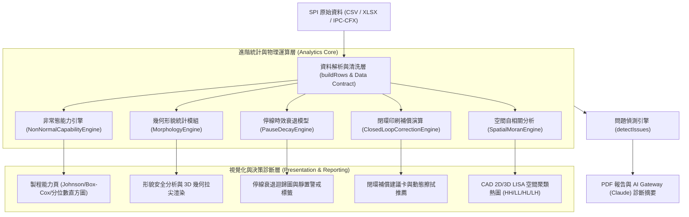
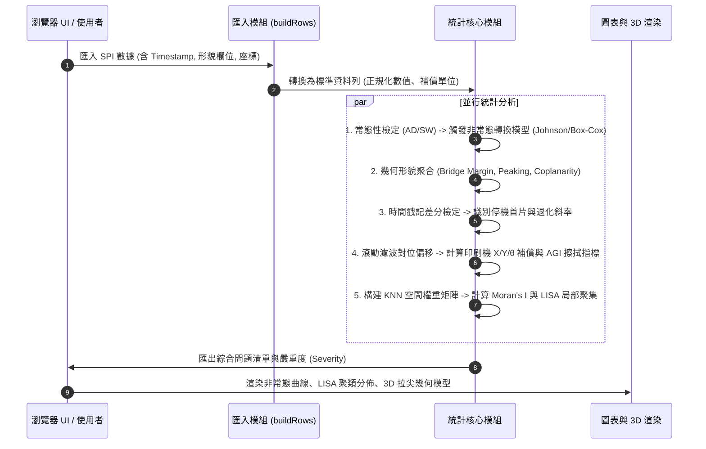

# SPI·SPC 進階五大功能擴充技術規格書 (RFC)
**文件編號**：RFC-SPI-2026-001  
**版本**：v1.0  
**日期**：2026-10-18  
**狀態**：草案 (Draft / For Review)  
**作者**：Antigravity Agent  
**審查對象**：SMT 品質工程師 (QE)、製程工程師 (PE)、統計軟體架構師  

---

## 1. 問題陳述與目標 (Problem Statement & Goals)

### 1.1 背景與問題 (Problem)
現行 SPI·SPC 分析台已具備三向法 $X̄-S$ 管制圖、Laney $P'$ 圖、Nelson 8 條判異規則、擦拭週期 Bonferroni 檢定、對位向量分解與 12 種印刷失效模式比對等完整體系。然而在面對「高密度極細間距封裝（01005、008004、0.3mm BGA/WLCSP）」、「嚴苛車規與航太高可靠度稽核」及「工業 4.0 智慧製造全閉環產線」時，現有系統面臨五項技術邊界與挑戰：

1. **非常態分佈能力失真**：微型開孔因脫模物理極限與孔壁拖尾效應，體積與高度分佈呈現明顯偏態或厚尾。常態檢定失敗時，強行套用常態 $C_{pk}$ 會嚴重扭曲理論 PPM。
2. **缺乏幾何立體形貌指標**：現行指標僅限 Volume、Height、Area、Offset，缺少相鄰焊墊「橋接間距餘裕（Bridge Gap/Margin）」、頂部「平整度/共面性（Coplanarity）」與「拉尖（Peaking/Dog-ear）」等直接引發回焊短路與立碑的微觀特徵。
3. **停線時效與環境流變衰退盲區**：未能量化 SMT 產線停線（換料、排故、交接班）導致的「停線首片（First Print After Pause）」錫膏溶劑揮發與黏度退化曲線。
4. **缺乏閉環回饋指引 (Closed-Loop Printer Correction)**：無法將多板累積之對位與溢錫統計量，直接轉換為印刷機台（Screen Printer）的即時補償向量（Offset/Theta）與動態清潔指令。
5. **缺少非線性局部空間群聚檢定**：現有平面梯度僅能辨識全板一階線性傾斜，無法偵測局部頂針懸空、載具局部微型塌陷所引起的局部微區群聚（Spatial Clustering）。

### 1.2 目標 (Goals)
1. 提供符規（ISO 21747 / Minitab 相容）之非常態製程能力引擎（Box-Cox、Johnson 轉換、經驗百分位數法）。
2. 擴充資料契約，解析並統計五大 3D 形貌特徵（Bridge Margin、Peaking、Coplanarity、Coverage、Slump），並連動 3D 沉積幾何渲染。
3. 建立時間戳記差分模型，自動標定停線首片，回歸停線靜置時間（Pause Dwell Time）與體積衰退斜率，計算安全靜置門檻。
4. 提供印刷機閉環補償計算器（阻尼濾波 X/Y/$\theta$ 修正量）與孔周溢錫動態擦拭觸發演算法（動態 AGI 指標）。
5. 實作空間統計自相關引擎（全局 Moran's I 與局部 LISA 聚類圖），精準標定 High-High 與 Low-Low 載具/頂針異常熱區。

### 1.3 非目標 (Non-goals)
- 本 RFC 不實作與實體機台的直接硬體 SECS/GEM 或 TCP 串接通訊（維持由檔案、API 或 IPC-CFX 匯入/匯出交換）。
- 不破壞現行純前端純瀏覽器（無伺服器計算依賴、支援離線）架構。
- 嚴格遵守「無彈出視窗（No-Popup Rule）」：所有新圖表、參數微調與報告皆採就地展開或整頁路由顯示。

---

## 2. 系統架構與資料流 (System Architecture & Data Flow)

### 2.1 組件階層架構 (Component Architecture)



### 2.2 核心計算流程時序 (Execution Sequence)



---

## 3. 詳細模組設計與數學規範 (Mathematical & Technical Specifications)

---

### 功能模組一：非常態分佈能力分析 (Non-normal Process Capability)

#### 1. 觸發與決策樹 (Decision Logic)
1. 對每組「元件群組 $\times$ 量測項目」，計算 Anderson-Darling 統計量 $A^2$ 與 $p$ 值。
2. 若 $p \ge 0.05$：維持標準常態分佈模式（現有演算法）。
3. 若 $p < 0.05$：標註「顯著非常態」，依據使用者設定或系統自動最優化挑選轉換方法：
   - 偏好順序：**Johnson 系統轉換 $\to$ Box-Cox 冪次轉換 $\to$ ISO 21747 經驗百分位數法**。

#### 2. 數學演算法規範

##### (A) Box-Cox 冪次轉換 (Box-Cox Power Transformation)
- **限定條件**：數據集合全部 $X_i > 0$。
- **目標**：在區間 $\lambda \in [-5, 5]$ 內以黃金分割搜尋法（Golden Section Search）最大化對數似然函數：
  $$L(\lambda) = -\frac{N}{2} \ln(\hat{\sigma}^2(\lambda)) + (\lambda - 1) \sum_{i=1}^N \ln(X_i)$$
  其中 $\hat{\sigma}^2(\lambda)$ 為轉換後序列 $X_i^{(\lambda)}$ 之變異數：
  $$X_i^{(\lambda)} = \begin{cases} \frac{X_i^\lambda - 1}{\lambda} & (\lambda \ne 0) \\ \ln(X_i) & (\lambda = 0) \end{cases}$$
- **規格映射**：將 LSL、USL、Target 依相同 $\lambda$ 轉換為 $LSL^{(\lambda)}, USL^{(\lambda)}$，於轉換後空間計算：
  $$C_{pk}^{(\lambda)} = \min\left(\frac{USL^{(\lambda)} - \mu^{(\lambda)}}{3\sigma^{(\lambda)}}, \frac{\mu^{(\lambda)} - LSL^{(\lambda)}}{3\sigma^{(\lambda)}}\right)$$
- **理論 PPM 估算**：
  $$\text{PPM} = 10^6 \times \left[ \Phi\left(\frac{LSL^{(\lambda)} - \mu^{(\lambda)}}{\sigma^{(\lambda)}}\right) + \left(1 - \Phi\left(\frac{USL^{(\lambda)} - \mu^{(\lambda)}}{\sigma^{(\lambda)}}\right)\right) \right]$$

##### (B) Johnson 系統轉換 (Johnson System Transformation)
- 將非標分佈變換至標準常態 $Z \sim \mathcal{N}(0, 1)$：
  $$Z = \gamma + \eta \cdot f\left(\frac{X - \epsilon}{\lambda}\right)$$
- 函式 $f(u)$ 包含三種族系：
  1. $S_B$（有界型，適用於體積百分比、面積百分比）：$f(u) = \ln\left(\frac{u}{1-u}\right), \quad 0 < u < 1$
  2. $S_L$（對數常態型）：$f(u) = \ln(u), \quad u > 0$
  3. $S_U$（無界型）：$f(u) = \sinh^{-1}(u) = \ln(u + \sqrt{u^2+1})$
- **參數估算**：採用動差匹配（Slifker-Shapiro 分位數法），取標準常態分位數 $z = 3z_0$ 對應的樣本經驗分位數，求解參數組 $(\gamma, \eta, \epsilon, \lambda)$。
- **能力計算**：以配適最佳（$p$ 值最高）的 Johnson 分佈曲線映射上下限：
  $$Z_{\text{USL}} = \gamma + \eta \cdot f\left(\frac{\text{USL} - \epsilon}{\lambda}\right), \quad Z_{\text{LSL}} = \gamma + \eta \cdot f\left(\frac{\text{LSL} - \epsilon}{\lambda}\right)$$
  $$C_{pk} = \min\left(\frac{Z_{\text{USL}}}{3}, \frac{-Z_{\text{LSL}}}{3}\right)$$

##### (C) ISO 21747 / DIN 55319 經驗百分位數法 (Non-parametric Percentile Method)
- 免轉換模型，適用於多峰分佈或轉換後仍無法通過常態檢定之頑固數據：
  - 取第 $0.135\%$ 分位數 $X_{0.135\%}$（對應常態 $-3\sigma$ 等效點）。
  - 取中位數 $X_{50\%}$（對應常態中心等效點）。
  - 取第 $99.865\%$ 分位數 $X_{99.865\%}$（對應常態 $+3\sigma$ 等效點）。
- 經驗製程能力指標：
  $$P_{pk, \text{np}} = \min\left(\frac{\text{USL} - X_{50\%}}{X_{99.865\%} - X_{50\%}}, \frac{X_{50\%} - \text{LSL}}{X_{50\%} - X_{0.135\%}}\right)$$
  $$P_{p, \text{np}} = \frac{\text{USL} - \text{LSL}}{X_{99.865\%} - X_{0.135\%}}$$

---

### 功能模組二：幾何形貌與缺陷細節指標 (Solder Paste Morphology)

#### 1. 擴充資料欄位規格 (Extended Data Fields)
擴充 `buildRows` 與欄名對應字典（中英文自動適配）：

| 標準變數名 | 欄名中英別名 | 物理意義 | 單位 | 預設規格門檻 (典型值) |
| :--- | :--- | :--- | :---: | :--- |
| `bridgeGap` | BridgeGap, Gap, 橋接間距, 錫膏間距 | 相鄰沉積物邊緣之最短幾何距離 | $\mu\text{m}$ | $\text{LSL} = 50\,\mu\text{m}$ |
| `bridgeMargin` | BridgeMargin, 橋接裕度, 間距比 | $\frac{\text{BridgeGap}}{\text{PadPitch} - \text{PadWidth}} \times 100\%$ | $\%$ | $\text{LSL} = 30\%$ |
| `peaking` | Peaking, DogEar, 拉尖, 尖峰高 | 頂部局部凸起峰值減去主體平均高度 | $\mu\text{m}$ | $\text{USL} = 30\,\mu\text{m}$ |
| `coplanarity` | Coplanarity, Flatness, 共面度, 平整度 | 沉積物表面最高點與最低點落差 | $\mu\text{m}$ | $\text{USL} = 25\,\mu\text{m}$ |
| `coverage` | Coverage, 覆蓋率, 潤濕覆蓋 | 錫膏投影面積 / 焊墊銅箔面積 $\times 100\%$ | $\%$ | $85\% \sim 115\%$ |
| `slump` | Slump, 坍塌量, 邊緣擴散 | 沉積物底面超出開孔邊界之橫向擴散量 | $\mu\text{m}$ | $\text{USL} = 25\,\mu\text{m}$ |

#### 2. 形貌異常偵測與物理規則整合 (Physics-driven Rules)
在 `detectIssues()` 中新增形貌問題偵測類別：

1. **`ISSUE_MORPH_BRIDGE_RISK`（橋接高風險）**：
   - 條件：焊墊的 `bridgeMargin` $< 25\%$ 或 `bridgeGap` $< 40\,\mu\text{m}$，且出現在 Fine-pitch（間距 $\le 0.4\,\text{mm}$）元件。
   - 物理推論：鋼板底面滲錫、鋼網密封性（Gasketing）不足、下頂針支撐力不足導致印刷時 PCB 下陷回彈。
2. **`ISSUE_MORPH_PEAKING`（脫模拉尖）**：
   - 條件：群組中 `peaking` 穩健 $z \ge 4.5$ 且觀測值 $> 35\,\mu\text{m}$。
   - 物理推論：鋼網脫模分離速度（Separation Speed）過快、鋼網開孔孔壁粗糙（Laser burr 無電解拋光）、或錫膏溶劑過度揮發造成黏度過高。
3. **`ISSUE_MORPH_POOR_COPLANARITY`（表面共面度不良）**：
   - 條件：單板多個焊點 `coplanarity` 超標，伴隨高度下降。
   - 物理推論：刮刀壓力過大導致「掏錫（Scooping）」現象，大開孔焊墊中間被挖空。

#### 3. 3D 模擬渲染擴充 (Three.js 3D Mesh Deformation)
- 修改 `build3D()` 頂點幾何產生邏輯：
  - 現狀：平頂六面柱體（BoxGeometry）。
  - 新增：採用客製化網格 `ParametricGeometry` 或頂點位移 Shader。
  - 當存在 `peaking` 時，沿邊緣頂點或中心頂點施加高斯隆起：
    $$z(x, y) = H_{\text{base}} + H_{\text{peak}} \cdot \exp\left(-\frac{(x - x_0)^2 + (y - y_0)^2}{2\sigma^2}\right)$$
  - 當存在 `slump` 時，底面頂點依坍塌係數向外擴散：$W_{\text{base}} = W_{\text{aperture}} + 2 \times \text{Slump}$。

---

### 功能模組三：停線時效與環境溫濕度關聯 (Pause Time & Stencil Life Decay)

#### 1. 停線區間檢定演算法 (Pause Detection Algorithm)
1. 排序時間序列：依據板的時間戳記 $T_i$ 嚴格升冪排序。
2. 計算相鄰印刷間隔：$\Delta T_i = T_i - T_{i-1}$。
3. 判定停線事件：
   $$\text{IsPostPauseBoard}(i) = \text{True} \iff \Delta T_i \ge T_{\text{threshold}} \quad (\text{預設門檻 } 15 \text{ 分鐘})$$
4. 追蹤停線後恢復軌跡：標記停線後連續第 1 片、第 2 片、第 3 片板（驗證幾片後製程重回穩態）。

#### 2. 時效衰退迴歸模型 (Decay Modeling & Stencil Life)
- **分析量測項目**：停線後首片的體積轉移效率（$\Delta \text{TE}$）、高度差與拉尖增量。
- **擬合指數衰退曲線**：
  $$\text{Volume}(\Delta T) = V_{\text{steady}} - \alpha \cdot \left(1 - \exp\left(-\frac{\Delta T}{\tau}\right)\right)$$
  其中 $\tau$ 為錫膏溶劑揮發時間常數，$\alpha$ 為最大揮發脫模損耗。
- **計算「安全靜置門檻 (Safe Dwell Limit)」**：
  - 定義容許體積下降極限（如 $\Delta \text{Volume} \le 8\%$）。
  - 反推臨界安全停線時間 $T_{\text{safe}}$：
    $$T_{\text{safe}} = -\tau \cdot \ln\left(1 - \frac{\Delta V_{\text{limit}}}{\alpha}\right)$$
- **溫濕度交叉影響 (若具備環境資料)**：
  - 當環境溫度 $> 26^\circ\text{C}$ 時，時間常數 $\tau$ 縮減 $30\%$（揮發加速）。
  - 當相對濕度 $> 65\%\,\text{RH}$ 時，標註吸濕警示（回焊後微爆錫珠風險）。

---

### 功能模組四：閉環控制回饋計算 (Closed-Loop Printer Correction)

#### 1. 閉環對位補償演算法 (Closed-loop Offset Correction)
- **目的**：避免單板隨機雜訊造成「過度補償（Hunting）」；只針對穩定系統性漂移進行補償。
- **輸入**：最近 $k$ 片連續生產板（預設 $k=3 \sim 5$）之焊墊偏移中位數向量 $(O_{x, b}, O_{y, b})$ 與旋轉角 $\theta_b$。
- **加權阻尼滾動修正量**：
  $$\Delta X_{\text{corr}} = -\alpha \cdot \frac{1}{\sum w_b} \sum_{b=1}^k w_b \cdot O_{x, b}$$
  $$\Delta Y_{\text{corr}} = -\alpha \cdot \frac{1}{\sum w_b} \sum_{b=1}^k w_b \cdot O_{y, b}$$
  $$\Delta \theta_{\text{corr}} = -\alpha \cdot \frac{1}{\sum w_b} \sum_{b=1}^k w_b \cdot \theta_b$$
  其中：
  - 阻尼係數 $\alpha = 0.6$（防振盪保護因子，限制單次修正不超過實際測得偏差的 $60\%$）。
  - 單次最大安全調整步階（Clamp Limit）：$|\Delta X_{\text{corr}}| \le 20\,\mu\text{m}$、$|\Delta Y_{\text{corr}}| \le 20\,\mu\text{m}$、$|\Delta \theta_{\text{corr}}| \le 0.05^\circ$。
  - 死區（Deadband）：當計算值 $< 3\,\mu\text{m}$ 或 $< 0.005^\circ$ 時不調整，避免頻繁微調耗損馬達。

#### 2. 動態鋼網清潔觸發 (Dynamic Wipe Trigger: AGI 指標)
- **傳統缺點**：固定每 $N$ 片擦拭一次，易在乾淨時浪費耗材，或在突發滲錫時無法及時清潔。
- **演算法：孔周滲錫累積指數 (Aperture Gasketing Index, AGI)**：
  $$\text{AGI}_b = \sum_{p \in \text{Pads}} \max\left(0, \frac{\text{Slump}_p - \text{Slump}_{\text{safe}}}{\text{Slump}_{\text{safe}}}\right) + \sum_{p \in \text{Pads}} \mathbb{I}(\text{BridgeMargin}_p < 30\%)$$
- **觸發條件**：
  - 當 $\text{AGI}_b > \text{AGI}_{\text{threshold}}$（基於訓練基準值之 $3\sigma$）：發出「即刻清潔鋼網」警示。
  - 建議清潔模式：依據污染源特性推薦「乾擦 (Dry) $\to$ 真空 (Vacuum)」或「溶劑濕擦 (Solvent Wet) $\to$ 真空」。

---

### 功能模組五：空間自相關與群聚統計 (Spatial Autocorrelation: Moran's I & LISA)

#### 1. 空間權重矩陣建立 (Spatial Weight Matrix)
- 針對單片板內的所有有效焊墊座標 $(X_i, Y_i)$，建立反距離加權矩陣（或 $k$ 最近鄰 KNN，$k=6$）：
  $$w_{ij} = \begin{cases} \frac{1}{d_{ij}^p} & (i \ne j \text{ 且 } d_{ij} \le d_{\text{cutoff}}) \\ 0 & (\text{其他}) \end{cases}$$
- 列標準化（Row-standardization）：
  $$w_{ij}^* = \frac{w_{ij}}{\sum_{j=1}^N w_{ij}} \implies \sum_{j=1}^N w_{ij}^* = 1$$

#### 2. 全局 Moran's I 統計量
$$I = \frac{N}{S_0} \frac{\sum_{i=1}^N \sum_{j=1}^N w_{ij}^* (z_i - \bar{z})(z_j - \bar{z})}{\sum_{i=1}^N (z_i - \bar{z})^2}, \quad S_0 = \sum_{i=1}^N \sum_{j=1}^N w_{ij}^* = N$$
- **顯著性檢定 ($Z$ 檢定)**：
  $$Z_I = \frac{I - \mathbb{E}[I]}{\sqrt{\text{Var}(I)}}, \quad \mathbb{E}[I] = -\frac{1}{N - 1}$$
  - 若 $Z_I > 2.58$（$p < 0.01$）：全板顯著呈現空間正自相關（非隨機，具強烈空間聚集）。

#### 3. 局部 LISA (Local Indicators of Spatial Association) 聚類分類
每個焊墊 $i$ 的局部 Moran's $I_i$：
$$I_i = \frac{z_i - \bar{z}}{s^2} \sum_{j=1}^N w_{ij}^* (z_j - \bar{z})$$
依據焊墊自身值與相鄰空間滯後值（Spatial Lag $\sum_j w_{ij}^* z_j$），分類為四個象限：

| LISA 象限 | 空間特徵代碼 | 視覺染色 | SMT 物理根因判斷 |
| :--- | :--- | :--- | :--- |
| **High-High** | 熱點 (Hot Spot) | 鮮紅 | 局部焊膏過多：鋼板局部變形鼓起、刮刀在該區局部抬升、或頂針過高頂起。 |
| **Low-Low** | 冷點 (Cold Spot) | 深藍 | 局部焊膏過少：PCB 局部下陷懸空（缺頂針支撐）、鋼板局部被壓傷凹陷。 |
| **Low-High** | 凹陷離群 (Outlier LH) | 天藍 | 周遭正常/偏高，但單點異常低：特定開孔堵塞或孔壁沾錫未脫膜。 |
| **High-Low** | 突起離群 (Outlier HL) | 橙黃 | 周遭正常/偏低，但單點異常高：特定開孔幾何設計過大或局部錫渣掉落。 |
| **Not Significant** | 隨機分佈 (NS) | 灰色 | 空間上呈隨機分佈之正常雜訊（$p \ge 0.05$）。 |

---

## 4. 介面互動與視覺化規範 (UI/UX Specifications)

依據系統總原則，**嚴禁彈出視窗**，所有新功能均於既有工作面板就地展開或整頁展示：

### 4.1 製程能力頁 (`#p-capability`) 擴充
1. **模型選擇下拉選單**：新增在子選單列（不遮蔽主要圖表）：
   - `[自動偵測模式 (預設) | 標準常態 | Box-Cox 冪次變換 | Johnson 系統轉換 | ISO 21747 百分位數法]`。
2. **能力摘要卡片呈現**：
   - 若為轉換模式，卡片顯示：「**$C_{pk}$（Johnson 轉換）** 1.42 · 原資料 AD 檢定 $p < 0.001$ · 變換模型 $S_B$（參數：$\gamma=-0.42, \eta=1.28$）」。
   - 理論 PPM 註明「轉換後反推等效值」。
3. **Q-Q 圖與配適曲線**：
   - 繪製實測分佈直方圖疊加 Johnson / Box-Cox 配適之非常態機率密度曲線（藍色實線）。

### 4.2 形貌與空間自相關分析頁 (`#p-adv` 進階分析) 擴充
1. **子頁籤導覽**：於「進階分析」面板頂部新增切換按鈕組：
   - `[刮刀/擦拭 | 對位向量 | 形貌缺陷 | 停線時效衰退 | LISA 空間聚類]`。
2. **LISA 空間聚類視圖**：
   - 採用 CAD 2D Canvas（同焊墊熱圖方向，Y 向上）。
   - 提供按鈕篩選 `[全部 | 只看 High-High 熱區 | 只看 Low-Low 冷區 | 只看空間離群]`。
   - 點擊特定聚類焊墊，就地展開顯示該焊墊之位號（RefDes）、觀測值、相鄰焊墊平均值及 LISA $p$ 值。

### 4.3 閉環與 DFM 建議頁 (`#p-dfm`) 擴充
1. **印刷機補償建議表（可直接複製或匯出）**：
   - 顯示：$\Delta X$、$\Delta Y$、$\Delta \theta$ 之建議微調值（附死區與阻尼保護說明）。
   - 「鋼網清潔建議」狀態指示：`[目前正常 | 建議下片執行乾擦 | 嚴重滲錫：建議執行濕式清洗]`。
2. **匯出格式**：提供「匯出印刷機補償參數 (.json / .csv)」按鈕。

---

## 5. 資料契約與 API 介面規格 (Data Contracts & APIs)

### 5.1 匯入格式相容性 (`buildRows` Schema)
擴充解析器，自動識別以下欄位：
```typescript
interface ExtendedMeasurementRow {
  // 既有基礎欄位
  board: string | number;
  component: string;
  pad: string;
  x?: number;
  y?: number;
  volume?: number;    // %
  height?: number;    // µm
  area?: number;      // %
  offx?: number;      // µm
  offy?: number;      // µm
  time?: string;      // ISO 字串或 YMD/DMY 格式

  // 新增形貌擴充欄位 (選填，無值時優雅降級)
  bridgeGap?: number;     // µm
  bridgeMargin?: number;  // %
  peaking?: number;       // µm
  coplanarity?: number;   // µm
  coverage?: number;      // %
  slump?: number;         // µm
}
```

### 5.2 閉環回饋輸出結構 (`/api/printer-correction` 或 Client-side 匯出)
```json
{
  "runName": "Trial_Batch_04",
  "evaluatedBoards": ["B23", "B24", "B25"],
  "algorithm": "TrimmedMean_Damped_v1",
  "dampingFactor": 0.6,
  "corrections": {
    "offsetX_um": -4.2,
    "offsetY_um": 2.1,
    "offsetTheta_deg": 0.012,
    "actionRecommended": "APPLY_ON_NEXT_BOARD"
  },
  "stencilCleaning": {
    "triggerState": "CLEAN_RECOMMENDED",
    "agiIndex": 14.8,
    "agiThreshold": 10.0,
    "recommendedMode": "WET_VACUUM"
  },
  "generatedAt": "2026-10-18T03:35:00+08:00"
}
```

---

## 6. 效能、安全與測試驗證計畫 (Performance, Security & Verification)

### 6.1 運算效能防護 (Performance Guards)
1. **空間矩陣計算防護**：
   - 當單片板焊墊數 $N > 5,000$ 時，全距矩陣 $O(N^2)$ 計算量極大。
   - **防護措施**：採用空間格網分桶（Spatial Grid Binning），僅對半徑 $R \le 1.5\,\text{mm}$ 內的鄰居點進行權重計算，時間複雜度降為 $O(N \log N)$，確保在 20 萬點數據下於 1 秒內完成計算。
2. **Johnson 轉換收斂守衛**：
   - 數值逼近迭代次數上限設為 100 次，若未能在容差 $10^{-6}$ 內收斂，自動 Fail-closed 回退至「ISO 21747 經驗百分位數法」，不造成頁面凍結或拋出例外。

### 6.2 測試向量驗收規範 (Test Vectors TV-ADV)

| 測試編號 | 測試項目 | 輸入數據特徵 | 預期輸出結果 / 容差 |
| :--- | :--- | :--- | :--- |
| **TV-ADV-01** | Box-Cox 冪次轉換 | 右偏對數常態數據（$N=500, \mu=4.6, \sigma=0.5$） | 尋得最佳 $\lambda \approx 0.0 \pm 0.1$；轉換後序列 AD 檢定 $p > 0.10$。 |
| **TV-ADV-02** | Johnson $S_B$ 轉換 | 雙峰厚尾百分比數據（$N=1000$，$0 < X < 100$） | 成功分類為 $S_B$ 族系；計算所得 $C_{pk}$ 誤差與 Minitab 基準相比 $< 10^{-4}$。 |
| **TV-ADV-03** | 經驗百分位數能力 | 均勻分佈數據（$U(70, 130)$，規格 $60 \sim 140$） | $P_{pk,\text{np}} \approx 1.33 \pm 0.02$（分位數定位正確）。 |
| **TV-ADV-04** | 停線首片標記 | 包含 08:00:00、08:01:00、08:35:00（間隔 34 分鐘）之資料 | 第三片板正確標註為 `isPostPause=true`，停線時間長度標註 34 分鐘。 |
| **TV-ADV-05** | LISA 空間聚類識別 | 人工注入局部 $3 \times 3$ 焊墊矩陣體積 $+4\sigma$ 之合成資料 | 該 9 個焊墊之局部 Moran's $I_i$ 全部顯著，且全部標定為 **High-High (熱點)**。 |
| **TV-ADV-06** | 閉環補償阻尼限制 | 連續 3 片板平均偏移 $X = +30\,\mu\text{m}$ | 阻尼建議補償量受 Clamp 限制不得超過安全門檻 $-20.0\,\mu\text{m}$。 |

---

## 7. 結論與分期實施藍圖 (Phased Implementation Roadmap)

- **Phase 1 (統計核心)**：導入「非常態分佈能力分析（Johnson / Box-Cox / 百分位數）」與「資料契約形貌欄位擴充」。
- **Phase 2 (製程因果)**：導入「停線時效衰退曲線模型」與「空間自相關 Moran's I / LISA 聚類」。
- **Phase 3 (智慧閉環與 3D)**：完成「閉環印刷機補償建議器」與「3D 幾何拉尖與共面性頂點位移渲染」。
