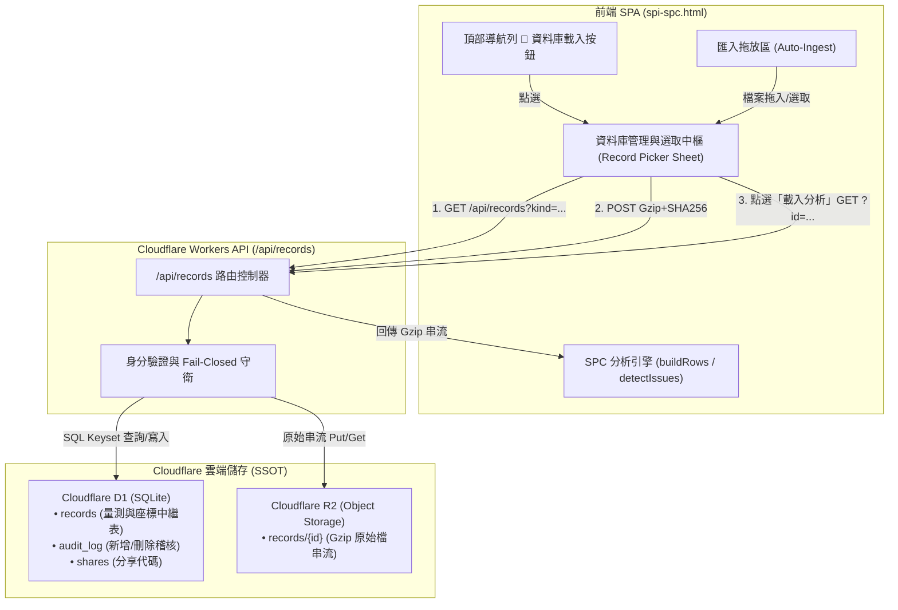
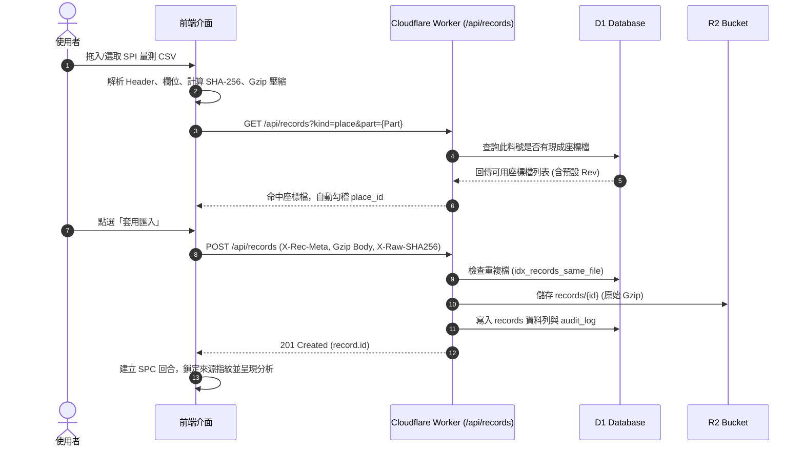
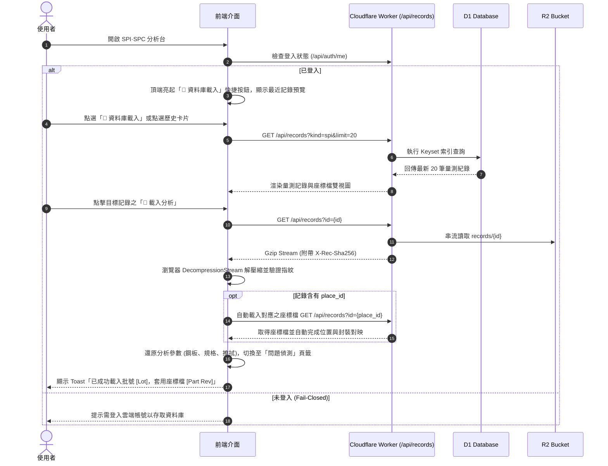

# SPI·SPC 量測記錄與座標檔雲端資料庫架構暨開機載入中樞規格書 (RFC)

> **規則更新（2026-10-23）**：座標檔版本占用、正式量測匯入、角色、原始檔保留及本機資料處理，改依 [RFC-SPI-COORD-20261023](rfc-controlled-coordinate-import.md)。下文的「自動套用最新／預設座標」、「原上傳者刪除原檔」、「量測必填批號」和「前端單獨驗證」已不適用於新的正式受控紀錄；既有歷史資料仍依原始引用與快照讀取。
**文件編號**：RFC-SPI-2026-002  
**版本**：v1.0  
**日期**：2026-10-18  
**狀態**：草案 (Draft / For Review)  
**作者**：Antigravity Agent  
**審查對象**：SMT 品質工程師 (QE)、製程工程師 (PE)、Cloudflare 全端架構師  

---

## 1. 問題陳述與目標 (Problem Statement & Goals)

### 1.1 背景與問題 (Problem Statement)
現行 SPI·SPC 分析台已具備三向法 $X̄-S$ 管制圖、Laney $P'$ 圖、Nelson 8 條判異規則、3D 錫膏模擬與進階五大分析特性。然而在「資料生命週期管理」與「跨工作階段持續性（Session Continuity）」方面，存在三項結構性痛點：

1. **開機無狀態與範例依賴（Startup Statelessness）**：
   - 目前使用者每次重新開啟程式（重新整頁、換瀏覽器分頁、下次重開機）時，系統預設還原範例資料（「試產 1 · 鋼板 V1」）或僅嘗試從瀏覽器本機快取讀取暫態回合。
   - 使用者無法在進入程式的第一時間，直覺地從資料庫選單中「點選歷史量測記錄」載入分析，必須重新找檔案或層層切換到設定頁籤底部的子分頁。
2. **量測記錄與座標檔脫節（Decoupled Asset Management）**：
   - SPI 量測記錄（CSV/XLSX）與 CAD/Gerber 座標檔（XY 位置、位號、封裝群組）為 SMT 製程分析的雙核心資產。
   - 現行系統中座標檔未建立結構化料號版本庫（Part Revision Catalog），量測檔載入後無法自動關聯對應料號的最新座標檔，造成焊墊定位與封裝分群屢屢需要人工重新指派。
3. **儲存架構相容性與合規邊界（Cloud-Native SSOT）**：
   - 依據專案核心規則（`GEMINI.md`），量測資料庫必須 100% 依賴 Cloudflare 雲端（D1 + R2），嚴格禁止在地 IndexedDB（LocalRec）降級，未登入時維持 Fail-Closed。
   - 需有完整的 D1 關聯資料庫 Schema、R2 物件分層防篡改指紋（SHA-256）與低延遲檢索設計，以滿足 Cloudflare Workers 免費方案的 CPU 10ms 與 D1 查詢預算上限。

### 1.2 目標 (Goals)
1. **開機即選即載（One-Click Startup Loader）**：
   - 程式開啟時，頂端與首頁提供顯著的「資料庫載入中樞（Database Quick Loader）」，使用者可直接點選既有記錄檔一鍵載入 SPC 儀表板。
2. **量測記錄與座標檔雙核心資料庫治理（Dual-Asset Catalog）**：
   - 結構化管理所有 SPI 原始量測檔與 CAD 座標檔，以「產品料號（Part Number）」為第一聚合維度，支援批號（Lot）、面別（Side）、工單（WO）、座標檔版本（Rev）之階層管理。
3. **自動關聯與分析狀態快照（Auto-Association & Config Snapshot）**：
   - 量測檔載入後自動寫入雲端 D1 + R2 並與料號座標檔建立雙向關聯；載入時自動還原當時的鋼板厚度、規格窗、擦拭次數與分析參數。
4. **100% 符合 Cloudflare 免費方案預算與 Fail-Closed 守則**：
   - 走 Keyset 游標分頁與單一索引覆蓋查詢，阻絕全表掃描；前端完成 Gzip 串流壓縮與 SHA-256 驗證，保護 Worker CPU 不超標。

### 1.3 非目標 (Non-goals)
- 本 RFC 不實作本機離線資料庫（維持依據 `GEMINI.md` 雲端 D1 + R2 單一真理源，不設 IndexedDB 雙軌同步）。
- 不開放修改已存入資料庫的原始量測檔案（維持 WORM 寫一次讀多次原則，保障品質稽核不可否認性，僅允許新增與由原上傳者刪除）。

---

## 2. 系統架構與互動資料流 (System Architecture & Data Flow)

### 2.1 系統架構圖 (Component Architecture)



### 2.2 核心操作循序圖 (Sequence Diagrams)

#### A. 檔案載入後自動納管與座標關聯 (Ingestion & Auto-Association)


#### B. 重新開啟程式時點選記錄載入 (Startup Reopen & Load)


---

## 3. 資料模型與介面契約 (Data Model & Interfaces)

### 3.1 D1 資料庫結構設計 (D1 SQLite Schema)

在現有 `0002_free_plan_schema.sql` 基礎上，擴充索引覆蓋並支援配置快照：

```sql
-- D1 Migration: 0005_record_catalog_enhancement.sql

-- 1. 為量測記錄增加料號關聯快速檢索索引 (加速依料號找歷史量測與座標)
CREATE INDEX IF NOT EXISTS idx_records_part_kind ON records (part, kind, created DESC);

-- 2. 為座標檔增加預設標記與查詢支援
-- records 表已具備 kind, part, rev, lot, side, vendor, place_id, name, user, created, bytes, gz_bytes, sha256, meta 欄位
-- meta 欄位結構化 JSON 規範擴充：
-- {
--   "rows": 12500,
--   "boards": 25,
--   "pads": 500,
--   "supplierWo": "SWO-202610-01",
--   "outsourceWo": "OWO-99120",
--   "isDefaultPlace": true,            -- 座標檔專用：是否為該料號目前預設版本
--   "comps": 450,                      -- 座標檔專用：元件數量
--   "cfgSnapshot": {                   -- 量測記錄專用：當初分析參數快照
--     "stencil": 120,
--     "wipe": 5,
--     "specs": { ... },
--     "metric": "volume"
--   }
-- }
```

### 3.2 儲存分層設計 (Storage Layer Layout)

| 儲存層級 | 儲存位置 | 內容格式 | 安全與防護特性 |
|---|---|---|---|
| **中繼與索引層** | Cloudflare D1 (`records`) | 結構化欄位 (Part, Lot, Rev, PlaceId, Fingerprint) | 嚴格外鍵對應、Keyset 分頁、防止全表掃描 |
| **稽核追蹤層** | Cloudflare D1 (`audit_log`) | 原子操作日誌 (Create, Delete, Target) | 僅限 Append、永不刪除、記錄操作者與時間戳 |
| **檔案本體層** | Cloudflare R2 (`records/{id}`) | 二進位 Gzip 壓縮資料流 (`application/gzip`) | 私有存取不對外公開、依 SHA-256 指紋驗證無篡改 |

### 3.3 API 契約規格 (API Contracts)

#### 1. 取得記錄清單 (`GET /api/records`)
- **Query 參數**：
  - `kind`: `spi` (量測記錄) 或 `place` (座標檔)
  - `part`: 可選，指定產品料號篩選
  - `cursor`: Keyset 游標 (`{created},{id}`)
  - `limit`: 每頁筆數 (預設 50，上限 100)
- **Response (200 OK)**：
  ```json
  {
    "records": [
      {
        "id": "AbCdEfGhIjKlMnOpQrStUv",
        "kind": "spi",
        "part": "301-000100124",
        "lot": "L2410-01",
        "side": "TOP",
        "vendor": "lirong",
        "place_id": "XyZ0123456789AbCdEfGhI",
        "name": "301_TOP_L2410.csv",
        "user": "engineer@company.com",
        "created": 1729252800000,
        "bytes": 5242880,
        "gz_bytes": 412900,
        "sha256": "e3b0c442...52b855",
        "meta": "{\"rows\":12500,\"boards\":25,\"pads\":500,\"supplierWo\":\"SWO-01\"}"
      }
    ],
    "next": "1729252800000,AbCdEfGhIjKlMnOpQrStUv",
    "me": "engineer@company.com"
  }
  ```

#### 2. 下載單筆原始檔 (`GET /api/records?id={id}`)
- **Response (200 OK)**：
  - `Content-Type`: `application/gzip`
  - `X-Rec-Sha256`: `e3b0c442...` (原始未壓縮 SHA-256)
  - `X-Raw-Bytes`: `5242880`
  - Body: Gzip 串流

---

## 4. UI/UX 規格與操作動線 (UI/UX Specification)

### 4.1 頂部導航列快速載入入口 (Top Bar Entry)
- 在桌面端頂部標題列與行動端 Sticky Rail 新增快捷按鈕：
  `[ 📂 載入記錄檔 ▾ ]`
- 按鈕狀態感知：若目前處於「範例資料」，按鈕顯示柔和脈衝醒目標示，導引使用者載入實際產線資料。

### 4.2 資料庫選取載入對話框 (Database Records Drawer / Modal)
採用響應式 Modal Sheet 設計（桌面端為置中大視窗，手機端為滑動抽屜），包含兩大分頁：
1. **量測記錄分頁 (Measurement Runs)**：
   - **快速搜尋列**：支援料號、批號、工單、上傳者即時過濾。
   - **記錄資訊卡/表格**：清楚列出批號、料號、工單、面別、板數×焊墊數、上傳時間、關聯座標檔狀態。
   - **操作按鈕**：
     - **`[ 🚀 載入分析 ]`**（主要動作，點擊立即從雲端下載、解壓、套用並切換至問題偵測）。
     - `[ 驗證指紋 ]`（重新核對 SHA-256）。
     - `[ 下載原始檔 ]`。
     - `[ 刪除 ]`（僅上傳者本人可見）。
2. **座標檔庫分頁 (Placement Library)**：
   - 依產品料號分組，條列該料號擁有的歷次座標檔版本（如 V1、V2）。
   - 提供「設為預設座標檔」切換開關，確保該料號後續匯入或載入量測檔時自動對應。

### 4.3 一鍵載入分析執行細節
當使用者點擊「🚀 載入分析」時：
1. 顯示全局非同步讀取狀態：`busy(true, "正在從雲端資料庫載入量測記錄…")`。
2. 串流下載 Gzip，前端透過 `DecompressionStream` 進行解壓縮。
3. 計算 SHA-256，確認與 D1 記錄指紋完全吻合（若不符則 Fail-Closed 報警中斷）。
4. 自動檢查 `place_id`：若有連結座標檔，背景自動一併取回該座標檔並掛載；若無連結但同料號有預設座標檔，主動提示「已自動對應此料號之座標檔 [Rev]」。
5. 解析資料表並建立回合，還原鋼板與規格設定，自動切換至「問題偵測 (issues)」頁籤，呈現完整分析成果。
6. 發出標準 Toast 提示：「已成功載入批號 [Lot] 量測資料（SHA-256 驗證通過）」。

---

## 5. 安全、效能防護與合規 (Security & Performance Guardrails)

1. **Fail-Closed 雲端單一來源**：
   - 遵從 `GEMINI.md`，資料庫功能 100% 依託 Cloudflare D1 + R2，徹底廢除本機 IndexedDB（LocalRec）寫入與降級分支。
   - 未登入使用者開啟資料庫時，明確提示「需登入雲端帳號以檢視與載入資料庫記錄」，不允許靜默退回本機假資料。
2. **Cloudflare 免費方案 CPU 10ms 防護**：
   - 壓縮（Gzip）與雜湊（SHA-256）計算 100% 由客戶端瀏覽器硬體加速處理，Worker 僅傳遞串流與執行 D1 Keyset 查詢，避免消耗邊緣運算 CPU。
3. **WORM 防篡改與稽核保留**：
   - 原始量測記錄與座標檔存入後禁止修改（No Update），刪除時檔案移出 R2，但 D1 `audit_log` 永久保留刪除軌跡與當時指紋。
